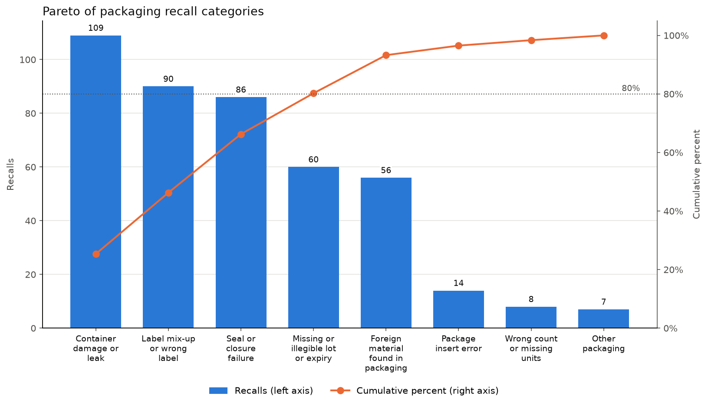
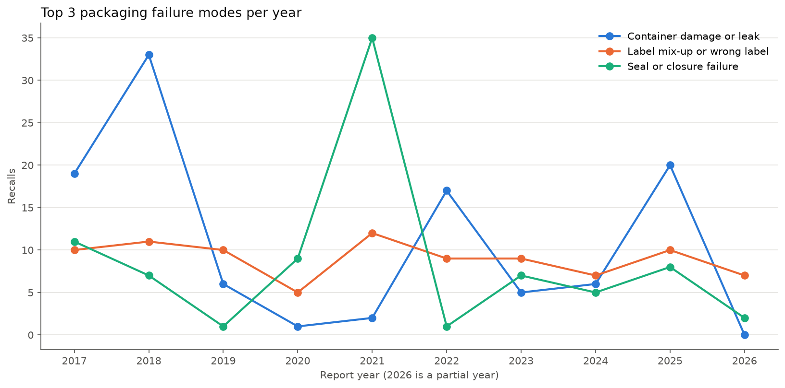

# Pharma Packaging Defect Log

A defect log and Pareto analysis of FDA drug recalls caused by packaging and labeling failures, focused on injectables.

Packaging teams track defects by type and watch how they trend over time, so they know which problems to go after first. I wanted to see what that picture looks like for the failures that actually made it to market, so I pulled every drug recall from FDA's public enforcement data, kept the packaging-related ones, sorted them into defect categories, and built the log in Excel.

Of 430 injectable packaging recalls reported from 2017 to 2026, three failure modes account for 66%: container damage or leaks, label mix-ups, and seal or closure failures.

## Data

FDA drug enforcement reports from the [openFDA API](https://open.fda.gov/apis/drug/enforcement/), pulled October 13, 2026 (API data last updated October 7, 2026). That's every classified drug recall since 2012, 18,010 records in total. The raw responses are saved in `data/raw/` so everything reruns offline.

## Results



| Category | Recalls | % | Cumulative % |
|---|---:|---:|---:|
| Container damage or leak | 109 | 25.3 | 25.3 |
| Label mix-up or wrong label | 90 | 20.9 | 46.3 |
| Seal or closure failure | 86 | 20.0 | 66.3 |
| Missing or illegible lot or expiry | 60 | 14.0 | 80.2 |
| Foreign material found in packaging | 56 | 13.0 | 93.3 |
| Package insert error | 14 | 3.3 | 96.5 |
| Wrong count or missing units | 8 | 1.9 | 98.4 |
| Other packaging | 7 | 1.6 | 100.0 |



By FDA recall class (Class I is the most serious, meaning a reasonable chance of serious harm):

| Category | Class I | Class II | Class III |
|---|---:|---:|---:|
| Container damage or leak | 8 | 101 | 0 |
| Label mix-up or wrong label | 32 | 26 | 32 |
| Seal or closure failure | 0 | 85 | 1 |
| Missing or illegible lot or expiry | 0 | 33 | 27 |
| Foreign material found in packaging | 25 | 30 | 1 |
| Package insert error | 4 | 4 | 6 |
| Wrong count or missing units | 0 | 5 | 3 |
| Other packaging | 0 | 5 | 2 |

## Findings

- **Four categories cover 80% of packaging recalls.** Container damage, label mix-ups, and seal failures make up 66%, and lot/expiry errors bring it to 80%.
- **Frequency and severity don't line up.** Label mix-ups and foreign material are 57 of the 69 Class I recalls. Seal failures are the third largest category but had no Class I recalls. Ranking by count alone would underrate foreign material.
- **Leaks are mostly IV bags; seal failures are mostly syringe caps and vial crimps.** 46 of the 109 container recalls describe leaking bags. Of the 86 seal failures, 39 involve syringe caps and 16 involve vial crimps.
- **The spikes are single events.** The 2021 jump in seal failures is one SCA Pharmaceuticals recall of defective syringe caps that covered 32 products. Counted by recall event instead of by product, label mix-ups are the largest category (74 events), ahead of container damage (54), foreign material (42), and seal failures (35).
- **Label mix-ups are steady.** They stay between 5 and 12 a year while the other categories swing. That points to an ongoing process gap, not a one-off.

## Recommendations

An in-line check for each of the top three failure modes, to catch it before product ships:

- **Container damage or leak:** 100% container closure integrity testing on the line. Use vacuum or pressure decay for bags, high voltage leak detection for liquid-filled vials and syringes, and camera inspection for cracks at the vial neck and heel. Most leaks in this data were found by customers.
- **Label mix-up:** vision and barcode verification of every unit, carton, and overwrap against the batch record, rejecting any mismatch. Back it up with documented line clearance between lots and label reconciliation (issued = used + destroyed).
- **Seal or closure failure:** camera inspection of every crimp and flip-off cap, capping force monitoring per head, and residual seal force testing on samples from each lot. A crimp can look fine and still be loose, so the force check catches what the camera can't.

Since foreign material is overrepresented in Class I recalls, it should be the next priority: tighter incoming inspection of glass and stoppers, and 100% visual inspection of filled units.

## Method

**Filtering.** A recall is kept if its `reason_for_recall` contains a packaging keyword as a whole word (vial, label, seal, crimp, leak, insert, expiry, and so on). After spot-checking random samples of kept and dropped recalls, I made two kinds of changes:

- **Removed false matches.** Some phrases use a keyword but aren't about packaging, like "all products within expiry" (sterility recalls), "stability data does not support expiry", and "below label claim" (potency). Those phrases are ignored when matching, which removed 862 false matches.
- **Added missed words.** These include plurals, "leaking", "cracked", "crimp", "pouch", "overwrap", and "short fill".

You can rerun the spot check with `python filter_recalls.py --review`.

3,030 recalls matched. To keep the log small enough to review every row by hand, I limited it to 500 rows: injectables first (841), then the most recent full years that fit, which gives 2017 to 2026 and 488 recalls. Injectable means an injection route in `openfda.route` (intravenous, intramuscular, subcutaneous, and so on) or a product description mentioning injection, vial, or syringe.

**Categories.** Each recall gets one of nine categories, defined on the Categories sheet, plus a short rationale. Rules that kept similar reasons consistent:

- A leak at a named seal, crimp, stopper, weld, seam, or port is a seal failure. A crack, pinhole, or unlocated leak is container damage.
- A wrong product or strength inside a labeled pack is a label mix-up, whether it's one unit or the whole pack.
- Particles inside the container are foreign material unless the reason traces them to the drug itself.
- Temperature excursions, potency, stability, and formulation problems are marked "Not packaging" even if the reason mentions a vial or label. 58 recalls fell here and are left out of the analysis.
- If a reason lists several problems, the first one wins.

**Review.** The Recall Log has a Reviewed Category column for a second, blind pass. Wherever it's filled in, it overrides Defect Category. `analyze.py` then adds a Review Check sheet with the agreement rate and every disagreement.

## Limitations

- **Recalls only show failures that reached the market.** Defects caught on the line or in inspection don't appear, so a site's internal defect log would look different.
- **Keyword filtering misses some recalls** whose reason text uses none of the keywords.
- **One recall event can cover many products.** Counts here are per product, which is why single events create the spikes noted above.
- **Categories are based on one or two sentences of recall text,** not a root cause investigation.
- **The scope is injectables from 2017 to 2026.** Oral solids would likely show more blister and bottle problems.
- **Many recalls come from 503B outsourcing facilities and repackagers,** whose processes differ from a large manufacturer's packaging line.

## Running it

```bash
python3 -m venv .venv
source .venv/bin/activate
pip install -r requirements.txt

python filter_recalls.py   # data/raw -> data/packaging_recalls.csv
python build_log.py        # Recall Log and Categories sheets
python analyze.py          # Pareto, Trend, By Class, Injectables sheets + charts/
```

`fetch_data.py` re-downloads the raw data (delete `data/raw/` first). `build_log.py` keeps anything entered in Reviewed Category, so it's safe to rerun. Close the workbook in Excel before running the scripts.
